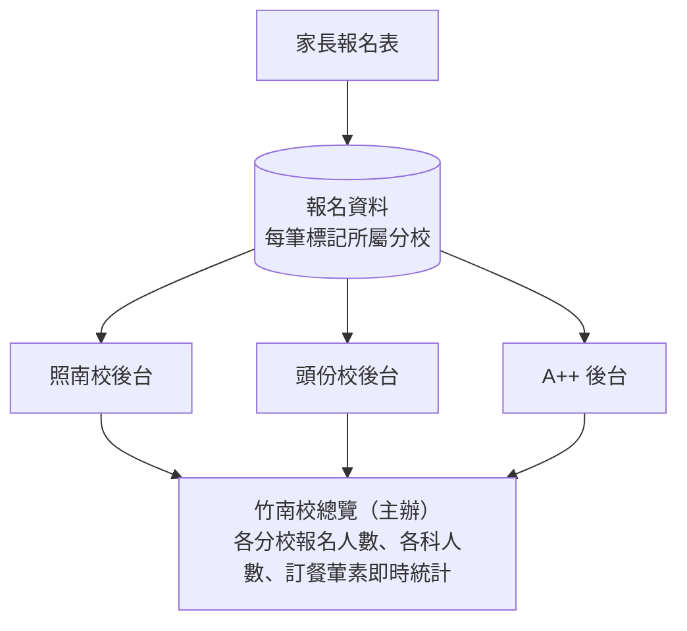

# 考猜多分校架構

> 狀態：暫緩（先跑通單一分校「金牌照南校」的報名流程，之後再做）
> 最後更新：2026-10-11

## 背景：實際的行政流程

- 活動由「金牌集團活動組」主辦，上課地點在**金牌竹南校**。
- 參加的單位不只一家：**金牌照南校**、**金牌頭份校**、**A++ 補習班**等。
- 每個分校**自己管理**要參加的學生（報名、修改、退選）。
- 各分校最後把**報名人數**和**訂餐人數**統計給竹南校，由竹南校統一安排。
- 竹南校最好有一個簡單的總覽頁面，可以**即時**看到各分校目前的報名人數。

## 架構草案

各分校後台只看得到、改得到自己分校的學生。

### 資料庫改動

| 項目 | 內容 |
|---|---|
| 新增 `special_branch` | 分校表：branch_id、名稱（照南／頭份／竹南／A++…）、是否為主辦 |
| `special_registration` 加欄位 | `branch_id`：這筆報名屬於哪個分校 |
| `staff`／`teacher` 權限 | 帳號綁定分校，並分成兩種角色：**分校管理員**、**主辦** |
| 資料庫權限規則 | 分校管理員只能讀寫 `branch_id` 等於自己分校的報名；主辦可以讀取全部的統計資料 |

權限要寫在資料庫的 RPC／RLS 裡，不能只靠網頁畫面藏起來，這樣分校之間才真的看不到彼此學生的個資。

### 後台改動

- **分校後台**：沿用現在的點名表、報名總表，但資料只顯示自己分校的學生。
- **竹南總覽**：一頁統計，依分校 × 科目列出報名人數，依分校 × 日期列出葷／素訂餐數，即時更新。

## 待決定的問題

1. **報名怎麼歸屬分校？**
   - 每個分校一條專屬報名連結（例如 `kaocai.html?branch=toufen`），或
   - 報名表讓家長自己從下拉選單選所屬補習班，或
   - 兩種都要。
2. **竹南（主辦）的權限範圍**：只看統計？還是也負責排座位、點名、訂餐（因為上課地點在竹南）？還是看得到、也改得到所有資料？
3. **其他分校的學生名單**：目前 `student` 表只有照南校的學生。其他分校要手動輸入，還是各自匯入名單？
4. **統計的提交方式**：竹南即時看就好、設報名截止時間，還是分校要按「提交」鎖定？
5. **「班內生／班外生」的定義**：多分校之後，可能改成「所屬補習班」，或「班內／班外」以各分校自己的學生來判斷。
6. **收費與對帳**：各分校分開收費、分開對帳嗎？班內和班外的價格是否不同？
